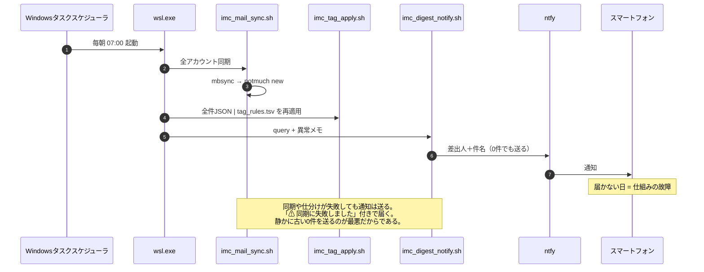

# imc — Daily Morning Aggregation of Messages Addressed to Me from Various Places, and Action-Required Notifications

## 1. Purpose (Who Is This For, and What Does It Do?)

The client is **the designer themselves (specifically, themselves in the morning, before their coffee)**.  
This person is not "unwilling to read" messages. They **don't know where to look**.  

Concrete failures to be solved:  

- A US bank login notification sent to a self-hosted mail server was missed, nearly causing the account to be deactivated (recurred multiple times)
- Gmail has a high volume, so important messages get buried
- Teams is "impossible to know about without opening it"

Success conditions:  

1. Action-required messages **always** reach the place the person looks (their smartphone) every morning  
2. A notification arrives even on days with 0 action-required items. **A day on which nothing arrives is a sign that the system is broken**  
3. Important senders such as banks are reliably caught by **sender rules**, not by the whims of an LLM  
4. All raw data remains locally. Afterwards, "where was that email?" can be answered  

Non-goals (what we won't do):  

- Sending or replying to email (left to viewing clients)  
- Centralized read-state management (we don't track read state on each service)  
- Real-time notification (once every morning is enough. Anything that isn't enough will arrive by phone call)  

## 2. Input (What Is the SSoT?)

| SSoT | Substance | Who Writes It |
|------|-----------|---------------|
| Raw message data | Emails on each IMAP server | External (senders) |
| Credentials | `.env` | **The user writes it by hand** |
| Sorting rules (publishable) | `tag_rules.tsv` | User (AI Agent only proposes) |
| Sorting rules (potentially personally identifying) | `tag_rules.local.tsv` | User (AI Agent only proposes) |

`_var/maildir/` is a **replica** of IMAP, not an SSoT. If deleted, it can be regenerated with mbsync.  
However, emails "deleted by the sending server" remain only in the replica, so it effectively functions as an archive.  

## 3. Interchange Format (Data Format Between Subsystems)

All subsystems communicate via TSV / JSON with **one message = one record**. Fields:  

| Column | Meaning |
|--------|---------|
| `message_id` | notmuch message-id (primary key) |
| `date_iso` | Received date and time (local time, ISO8601) |
| `account` | Name of the account fetched from (an element of `IMC_ACCOUNTS` in `.env`) |
| `from_addr` | Sender address |
| `from_name` | Sender display name |
| `subject` | Subject |
| `to` | Recipient (referenced by the `to` rule in `tag_rules.tsv`) |
| `tags` | notmuch tags, comma-joined |
| `path` | File path in Maildir (relative to `_var/`) |

Tabs and newlines within each TSV field are replaced with a single-byte space (to guarantee one record per line).  

## 4. Output (The Client's Input SSoT)

The client's (the morning self's) input SSoT is the **smartphone notification**.  
The sender + subject are sent to a dedicated ntfy topic (a **separate topic** from the Codex task-completion notifications).  

```
要対応 3件

- Bank of America: Sign-in from new device
- IRS: Notice CP2000
- selfhosted: cert expires in 7 days
```

On days with 0 items, `要対応 0件 / 全体 142件` arrives. **The non-arrival of this notification is the only means of anomaly detection.**  

However, "non-arrival" is not the only anomaly. If sync fails but the notification still arrives,  
**normal silence and a malfunction cannot be told apart**. So `imc_digest_notify.sh` takes
an anomaly note as its second argument, and `imc_morning_run.sh` passes sync and sorting failures to it.  

```
⚠ 同期に失敗しました。下の一覧は古い可能性があります。

要対応 0件 / 全体 142件

一覧が正しいとは限りません。WSLで確認してください。
```

### The Decision to Include Subjects in the Notification Body

KB-000002 decided that "only fixed text is used in the notification body" (to prevent leakage of Codex's conversation payload). This system **intentionally relaxes** that. Reasons:  

- With the sender alone, one cannot judge "whether I need to get up right now," so the purpose (preventing missed items) is not achieved
- If the public ntfy.sh server is used, subjects pass through a third-party server

Since the topic name is effectively a secret key, the leakage risk is low, but **never include the body, attachments, or URLs**.  
Beyond the subject, read in neomutt on WSL.  

## 5. Structure

```mermaid
flowchart LR
  subgraph External["外部（SSoT）"]
    S1[自前IMAP<br/>starship.jp]
    S5[Asahi Net<br/>POP3のみ]
    S2[Gmail IMAP]
    S3[Outlook IMAP<br/>OAuth2]
    S4[Teams<br/>Graph API]
  end

  subgraph Fetch["取得"]
    MB[mbsync<br/>既製品・IMAP専用]
    GM[getmail<br/>既製品・POP3専用]
    TG[imc_teams_fetch.sh<br/>自作]
  end

  MD[("_var/maildir/<br/>生データ全件")]

  subgraph Index["索引・仕分け"]
    NM[notmuch new]
    TA[imc_tag_apply.sh<br/>tag_rules.tsv (+.local)]
  end

  DB[("_var/notmuch/<br/>索引＋タグ")]

  subgraph Out["出力"]
    LS[imc_mail_list.sh<br/>tsv/json]
    NT[imc_digest_notify.sh]
    MU[neomutt<br/>既製品]
  end

  S1 --> MB
  S5 --> GM
  S2 --> MB
  S3 -.未実装.-> MB
  S4 --> TG
  MB --> MD
  GM --> MD
  TG --> MD
  MD --> NM --> DB
  DB --> TA --> DB
  DB --> LS
  DB --> MU
  LS --> NT --> P([スマートフォン])
```

Only **three thin pieces** are built in-house (sync / tag_apply / digest_notify).  
Fetching, indexing, and viewing are all left to off-the-shelf tools. For abstractions we cannot own, dependencies are minimized (Urushi no Kata).  

mbsync is IMAP-only and cannot speak POP3 at all. Because there are real **third-party ISPs that don't offer IMAP
(and where we have no administrator privileges)**, such as Asahi Net, getmail, which is POP3-only, is used
in parallel. Both are dispatched by `imc_mail_sync.sh` based on `PROTOCOL` in `.env`, and both follow the
"do not delete from the server" policy (mbsync's `Remove None` / getmail's
`delete = false`). The pipeline from notmuch onward is entirely unaware of the protocol.  

## 6. The Morning Sequence



Periodic execution is triggered from the Windows Task Scheduler, not WSL's cron.  
This is because WSL's cron doesn't run if WSL is down, and we would be unable to notice that "it didn't run."  

## 7. Convergence Verification on Rule Changes (DJC)

When `tag_rules.tsv` is changed, **reapply it to all past messages and look only at the diff**.  
No correct answer is defined in advance. We compare the output of the old rule A(x) and the new rule B(x) (Ni no Kata).  

```bash
imc_mail_list.sh '*' tsv > before.tsv
# tag_rules.tsv を編集
imc_mail_list.sh '*' json | imc_tag_apply.sh tag_rules.tsv --dry-run > plan.tsv
# plan.tsv が差分そのもの。見るべきはここだけ
imc_mail_list.sh '*' json | imc_tag_apply.sh tag_rules.tsv --confirm > /dev/null
imc_mail_list.sh '*' tsv > after.tsv
diff before.tsv after.tsv
```

If the diff is 0, that rule change **changed nothing**.  
If there is a diff, the human only needs to look at the diff set. There is no need to review everything.  

`imc_tag_apply.sh` is idempotent because it strips all rule-derived tags once and then reapplies them. Manually applied tags (such as `tag:done`) are not stripped. The two are distinguished by prefix:  

- Rule-derived: those written in the `tag` column of `tag_rules.tsv`
- Human-derived: everything else (`imc_tag_apply.sh` does not touch them)

### Subject Rules Take Priority; Sender Rules Go to a Non-Public File

Verification against real examples (two actual emails from a US bank) showed that the originally envisioned
policy of "reliably catching by sender domain" is **too coarse**.

```
"Here's the security code you requested"   ← 要対応
"Your e-statement is ready."               ← 通常の通知、要対応ではない
```

Both arrive from the same sender (`notifications.usbank.com`). Judging by sender alone
would mark even routine notifications like the second one as `actionable`, creating a "boy who cried wolf" situation.

Subject-based rules can make this distinction, and since they **don't identify the bank name**,
they can be written as-is in `tag_rules.tsv` (public). As a result, subject
rules turned out to be the main approach this time, rather than sender rules.

If senders still emerge for which the subject offers no clue, write them in `tag_rules.local.tsv`
(created by copying `tag_rules.local.tsv.template`; subject to `.gitignore`).
`imc_tag_apply.sh` accepts multiple rule files:

```bash
imc_mail_list.sh '*' json | imc_tag_apply.sh tag_rules.tsv tag_rules.local.tsv --confirm
```

`imc_morning_run.sh` automatically adds `tag_rules.local.tsv` only if it exists.

## 8. Stages

| Stage | Content | Status |
|-------|---------|--------|
| 1 | Self-hosted server IMAP → Maildir → full listing | Implemented |
| 2 | Sorting via tag_rules.tsv + morning notification | Implemented |
| 2.5 | POP3-only third-party ISP (getmail) | Implemented |
| 3 | Gmail (app password) | Possible by only appending to `.env` |
| 4 | Outlook (OAuth2 required) | Not implemented |
| 5 | Teams (Graph API, self-built) | Implemented |

Stage 2.5 is a branch for third-party ISPs that don't offer IMAP (and where we have no administrator privileges).
Because mbsync is IMAP-only and cannot speak POP3 at all, setting `PROTOCOL` in `.env` to `POP3` makes
`initialize.sh` generate configuration for `getmail` instead (`_var/getmail/getmailrc-<account>`). The server side is never touched.
Real example: Asahi Net (still active as a notification destination for AWS).

Stage 3 only requires adding an account to `.env` and rerunning `initialize.sh`.  
Stage 4 involves hooking an OAuth2 access-token retrieval script into mbsync's `PassCmd`.  
It is expected to have the same structure as `~/bin/gcal/refresh_access_token.sh` (not stated in the specification. This is conjecture).  

## 9. File Layout

```
imc/
├── README.md / README.en.md      GitHub向けの入口（この文書への導線）
├── design.md / design.en.md      この文書（一次情報。原本は日本語）
├── instructions_to_ai_agent.md   AI Agentへの指示（一次情報・編集禁止）
│   └── .en.md                    その英語版
├── LICENSE                       MIT
├── initialize.sh                 冪等な初期化（これ1本で使える状態になる）
├── .env.template                 ユーザーが .env へコピーして手で書く
├── tag_rules.tsv                 仕分けルール（一次データ・public）
├── tag_rules.local.tsv.template  同上・個人を特定しうる送信者ルール用
│   └── tag_rules.local.tsv       （.gitignore対象。ユーザーが作る）
├── imc_secret_get.sh             .env から1値を取り出す（mbsync/getmail 共用）
├── imc_mail_sync.sh              mbsync(IMAP) / getmail(POP3) → notmuch new
├── imc_tag_apply.sh/.py          ルールファイル(複数可)を全件へ再適用（stdin=全件JSON）
├── imc_mail_list.sh/.py          notmuch 検索 → tsv|json
├── imc_digest_format.py          一覧 → 通知本文
├── imc_digest_notify.sh          一覧 → 整形 → ntfy
├── imc_morning_run.sh            毎朝の一本道（タスクスケジューラが叩く）
└── _var/                         二次情報。.gitignore 対象
    ├── maildir/                  IMAP/POP3両方の複製
    ├── notmuch/                  索引DB
    ├── getmail/                  POP3アカウント用設定(getmailrc-<account>)・状態
    ├── mbsyncrc                  .env から自動生成（IMAPアカウントのみ）
    ├── notmuch-config            .env から自動生成
    └── log/
```

**Everything** inside `_var/` is regenerable. Delete it and run `initialize.sh` and `imc_mail_sync.sh`,  
and it returns to its original state. The leading `_` indicates "not primary information" (Fundamental Premise 2).  

## 10. Known Design Compromises

- **The ntfy sending logic is not shared with `~/bin/ntfy/`**. About 25 lines of curl are duplicated.
  Sharing "could" be done, but it is not something we are "forced" to do. The topics and purposes differ,  
  and the benefit of being able to understand and relocate this system as a standalone unit is greater.  
- **`_var/mbsyncrc` contains absolute paths**. This is unavoidable because the working directory of
  mbsync's `PassCmd` is not fixed. However, since it is a generated file and not tracked, the harm of the principle violation  
  does not leak outside the repository.  
- **Passwords are placed only in `.env`**. They are not written in the mbsync configuration file; they are read
  each time via `PassCmd`. `.env` must be mode 600. Scripts check the mode and refuse to run otherwise.
