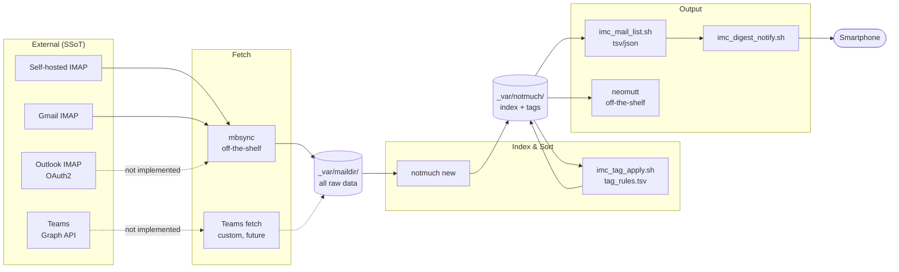
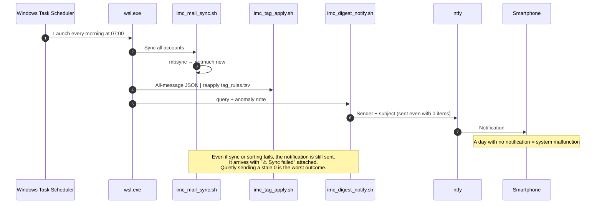

2026-10-14 07:44:15(JST) translate.sh: asking claude to translate Japanese -> English... (can take a few minutes for long documents)
2026-10-14 07:44:16(JST) translate.sh: still running, elapsed 1s (not blocked)
2026-10-14 07:44:17(JST) translate.sh: still running, elapsed 2s (not blocked)
2026-10-14 07:44:18(JST) translate.sh: still running, elapsed 3s (not blocked)
2026-10-14 07:44:19(JST) translate.sh: still running, elapsed 4s (not blocked)
2026-10-14 07:44:20(JST) translate.sh: still running, elapsed 5s (not blocked)
2026-10-14 07:44:21(JST) translate.sh: still running, elapsed 6s (not blocked)
2026-10-14 07:44:22(JST) translate.sh: still running, elapsed 7s (not blocked)
2026-10-14 07:44:23(JST) translate.sh: still running, elapsed 8s (not blocked)
2026-10-14 07:44:24(JST) translate.sh: still running, elapsed 9s (not blocked)
2026-10-14 07:44:25(JST) translate.sh: still running, elapsed 10s (not blocked)
2026-10-14 07:44:26(JST) translate.sh: still running, elapsed 11s (not blocked)
2026-10-14 07:44:27(JST) translate.sh: still running, elapsed 12s (not blocked)
2026-10-14 07:44:28(JST) translate.sh: still running, elapsed 13s (not blocked)
2026-10-14 07:44:29(JST) translate.sh: still running, elapsed 14s (not blocked)
2026-10-14 07:44:30(JST) translate.sh: still running, elapsed 15s (not blocked)
2026-10-14 07:44:31(JST) translate.sh: still running, elapsed 16s (not blocked)
2026-10-14 07:44:32(JST) translate.sh: still running, elapsed 17s (not blocked)
2026-10-14 07:44:33(JST) translate.sh: still running, elapsed 18s (not blocked)
2026-10-14 07:44:34(JST) translate.sh: still running, elapsed 19s (not blocked)
2026-10-14 07:44:35(JST) translate.sh: still running, elapsed 20s (not blocked)
2026-10-14 07:44:36(JST) translate.sh: still running, elapsed 21s (not blocked)
2026-10-14 07:44:37(JST) translate.sh: still running, elapsed 22s (not blocked)
2026-10-14 07:44:38(JST) translate.sh: still running, elapsed 23s (not blocked)
2026-10-14 07:44:38(JST) translate.sh: still running, elapsed 23s (not blocked)
2026-10-14 07:44:39(JST) translate.sh: still running, elapsed 24s (not blocked)
2026-10-14 07:44:40(JST) translate.sh: still running, elapsed 25s (not blocked)
2026-10-14 07:44:41(JST) translate.sh: still running, elapsed 26s (not blocked)
2026-10-14 07:44:41(JST) translate.sh: done (exit 0). Next: review the translated output.
# imc — Daily Morning Aggregation of Messages Addressed to You, and Action-Required Notifications

## 1. Purpose (Who Is This For, and What Does It Do?)

The client is **the designer themselves (specifically, themselves in the morning, before the first coffee)**.  
This person is not "unwilling to read" messages. They **don't know where to look**.  

Concrete failures to solve:  

- Missed a US bank login notification sent to their self-hosted mail server, and nearly had the account deactivated (happened multiple times)
- Gmail has a high volume, and important messages get buried
- Teams is "impossible to tell without opening it"

Success conditions:  

1. Messages that need action **always** reach the place the person looks (their smartphone) every morning  
2. A notification arrives even on days with 0 items needing action. **A day with no notification is a sign that the system is broken**  
3. Important senders such as banks are caught reliably by **sender rules**, not by the whim of an LLM  
4. All raw data remains locally. Afterward, "where did that email go?" can still be answered  

Non-goals (what we do not do):  

- Sending or replying to mail (left to the viewing client)
- Unified read-state management (we do not track read state on each service)
- Real-time notification (once every morning is enough; anything that isn't will arrive by phone call)

## 2. Input (What Is the SSoT?)

| SSoT | Substance | Who Writes It |
|------|-----------|---------------|
| Raw message data | Mail on each IMAP server | External (senders) |
| Credentials | `.env` | **The user writes it by hand** |
| Sorting rules | `tag_rules.tsv` | The user (AI Agent only proposes) |

`_var/maildir/` is a **replica** of IMAP and not an SSoT. If deleted, it can be regenerated with mbsync.  
However, mail that "the source server has deleted" survives only in the replica, so it effectively functions as an archive.  

## 3. Exchange Format (Data Format Between Subsystems)

All subsystems talk to each other in TSV / JSON with **1 message = 1 record**. Fields:  

| Column | Meaning |
|--------|---------|
| `message_id` | notmuch message-id (primary key) |
| `date_iso` | Received date and time (local time, ISO8601) |
| `account` | Name of the source account (an element of `IMC_ACCOUNTS` in `.env`) |
| `from_addr` | Sender address |
| `from_name` | Sender display name |
| `subject` | Subject |
| `to` | Recipient (referenced by the `to` rule in `tag_rules.tsv`) |
| `tags` | notmuch tags joined with commas |
| `path` | File path in Maildir (relative to `_var/`) |

Tabs and newlines inside each TSV field are replaced with a single-byte space (to guarantee one record per line).  

## 4. Output (The Client's Input SSoT)

The client's (the morning self's) input SSoT is the **smartphone notification**.  
The sender + subject are sent to a dedicated ntfy topic (a **separate topic** from the Codex task-completion notifications).  

```
Action required: 3 items

- Bank of America: Sign-in from new device
- IRS: Notice CP2000
- selfhosted: cert expires in 7 days
```

On a day with 0 items, `Action required: 0 items / 142 total` is delivered. **The non-arrival of this notification is the only means of anomaly detection.**  

However, "non-arrival" is not the only anomaly. If sync fails and only the notification arrives,  
**normal quiet and a malfunction cannot be told apart**. So `imc_digest_notify.sh` takes
an anomaly note as its second argument, and `imc_morning_run.sh` passes sync and sorting failures into it.  

```
⚠ Sync failed. The list below may be outdated.

Action required: 0 items / 142 total

The list may not be accurate. Please check in WSL.
```

### Decision to Include Subjects in the Notification Body

KB-000002 decided that "the notification body uses only fixed text" (to prevent leaking Codex conversation payloads).  
This system **deliberately relaxes** that rule. Reasons:  

- Sender alone cannot tell whether "I need to get up right now," so it fails to achieve the purpose (preventing missed messages)
- If the public ntfy.sh server is used, the subject passes through a third-party server

Because the topic name is effectively a secret key, the leak risk is low, but **never include the body, attachments, or URLs**.  
Anything beyond the subject is read in neomutt on WSL.  

## 5. Structure



Only **three thin pieces** are built in-house (sync / tag_apply / digest_notify).  
Fetching, indexing, and viewing are all left to off-the-shelf tools. Abstractions we cannot own are kept to minimal dependency (Urushi no Kata).  

## 6. Morning Sequence



Periodic execution is triggered from Windows Task Scheduler, not WSL's cron.  
This is because WSL's cron does not run if WSL is down, and we would not notice that "it did not run".  

## 7. Convergence Verification on Rule Changes (DJC)

After changing `tag_rules.tsv`, **reapply it to all past messages and look only at the diff**.  
No correct answer is defined in advance. We compare the output of the old rule A(x) with that of the new rule B(x) (Ni no Kata).  

```bash
imc_mail_list.sh '*' tsv > before.tsv
# edit tag_rules.tsv
imc_mail_list.sh '*' json | imc_tag_apply.sh tag_rules.tsv --dry-run > plan.tsv
# plan.tsv is the diff itself. This is the only thing to look at
imc_mail_list.sh '*' json | imc_tag_apply.sh tag_rules.tsv --confirm > /dev/null
imc_mail_list.sh '*' tsv > after.tsv
diff before.tsv after.tsv
```

If the diff is 0, that rule change **changed nothing**.  
If there is a diff, the human only needs to look at the diff set. There is no need to review everything.  

`imc_tag_apply.sh` is idempotent because it strips all rule-derived tags once and then reapplies them.  
Tags applied by hand (such as `tag:done`) are not stripped. The two are distinguished by prefix:  

- Rule-derived: those written in the `tag` column of `tag_rules.tsv`
- Human-derived: everything else (`imc_tag_apply.sh` does not touch these)

## 8. Stages

| Stage | Content | Status |
|-------|---------|--------|
| 1 | Self-hosted server IMAP → Maildir → full listing | Implemented |
| 2 | Sorting via tag_rules.tsv + daily notification | Implemented |
| 3 | Gmail (app password) | Possible by only appending to `.env` |
| 4 | Outlook (requires OAuth2) | Not implemented |
| 5 | Teams (Graph API, custom-built) | Not implemented |

For stage 3, it is enough to add the account to `.env` and rerun `initialize.sh`.  
For stage 4, put an OAuth2 access-token retrieval script into mbsync's `PassCmd`.  
It is expected to have the same structure as `~/bin/gcal/refresh_access_token.sh` (not stated in the spec; this is a guess).  

## 9. File Layout

```
imc/
├── README.md / README.en.md      Entry point for GitHub (pointer to this document)
├── design.md / design.en.md      This document (primary source. The original is in Japanese)
├── instructions_to_ai_agent.md   Instructions to the AI Agent (primary source, do not edit)
│   └── .en.md                    English version of the above
├── LICENSE                       MIT
├── initialize.sh                 Idempotent initialization (this one script makes it usable)
├── .env.template                 The user copies it to .env and writes it by hand
├── tag_rules.tsv                 Sorting rules (primary data)
├── imc_secret_get.sh             Extracts one value from .env (for mbsync PassCmd)
├── imc_mail_sync.sh              mbsync → notmuch new
├── imc_tag_apply.sh/.py          Reapply tag_rules.tsv to all messages (stdin = all-message JSON)
├── imc_mail_list.sh/.py          notmuch search → tsv|json
├── imc_digest_format.py          List → notification body
├── imc_digest_notify.sh          List → format → ntfy
├── imc_morning_run.sh            The single morning path (run by Task Scheduler)
└── _var/                         Secondary information. Covered by .gitignore
    ├── maildir/                  Replica of IMAP
    ├── notmuch/                  Index DB
    ├── mbsyncrc                  Auto-generated from .env
    ├── notmuch-config            Auto-generated from .env
    └── log/
```

Everything inside `_var/` is **fully regenerable**. Delete it and run `initialize.sh` and `imc_mail_sync.sh`,  
and it returns to its original state. The leading `_` indicates "not primary information" (Core Premise 2).  

## 10. Known Design Trade-offs

- **The ntfy sending logic is not shared with `~/bin/ntfy/`**. About 25 lines of curl are duplicated.
  Sharing "could" be done, but it is not something we are "forced" to do. The topic and purpose differ, and  
  the benefit of being able to understand and relocate this system on its own is greater.  
- **`_var/mbsyncrc` contains absolute paths**. This is unavoidable because the working directory of
  mbsync's `PassCmd` is not fixed. However, it is a generated artifact and not tracked, so the harm of the principle violation  
  does not leak outside the repository.  
- **Passwords are placed only in `.env`**. They are not written in the mbsync config file but read
  each time via `PassCmd`. `.env` must be mode 600. Scripts check the mode and refuse to run otherwise.
