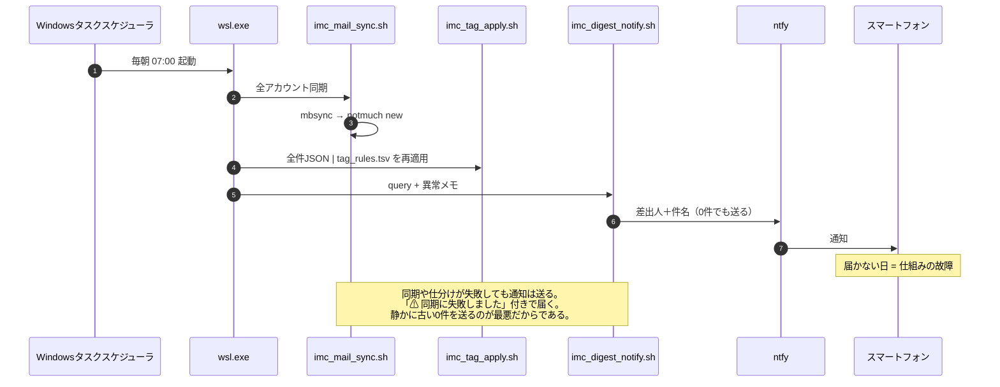

# imc — 各所に届く自分宛てメッセージの毎朝集約と要対応通知

## 1. 目的（誰のために何をするのか）

クライアントは**設計者本人（ただし朝の、まだコーヒーを飲んでいない状態の本人）**である。  
この人物は、メッセージを「読む気がない」のではない。**どこを見ればよいか分からない**のである。  

解決すべき具体的失敗:  

- 自前メールサーバー宛ての米国銀行ログイン通知を見逃し、口座が無効化されかける（複数回再発）
- Gmail は量が多く、重要なものが流れる
- Teams は「開かないと分からない」

成功条件:  

1. 要対応メッセージが、本人が見る場所（スマートフォン）へ毎朝**必ず**届く  
2. 要対応が0件の日も通知が届く。**届かない日があれば、それは仕組みの故障のサイン**である  
3. 銀行など重要な送信者は、LLMの気分ではなく**送信者ルール**で確実に拾う  
4. 生データは全件手元に残る。あとから「あのメールどこ？」が成立する

非目標（やらないこと）:  

- メールの送信・返信（閲覧クライアントに任せる）
- 既読管理の一元化（各サービス側の既読状態は追わない）
- リアルタイム通知（毎朝1回で足りる。足りないものは電話で来る）

## 2. 入力（SSoT は何か）

| SSoT | 実体 | 誰が書くか |
|------|------|-----------|
| メッセージ生データ | 各IMAPサーバー上のメール | 外部（送信者） |
| 認証情報 | `.env` | **ユーザーが手で書く** |
| 仕分けルール（公開可） | `tag_rules.tsv` | ユーザー（AI Agentは提案のみ） |
| 仕分けルール（個人を特定しうる） | `tag_rules.local.tsv` | ユーザー（AI Agentは提案のみ） |

`_var/maildir/` は IMAP の**複製**であって SSoT ではない。消しても mbsync で再生成できる。  
ただし「送信元サーバーが消したメール」は複製にしか残らないため、実質的なアーカイブとして機能する。  

## 3. 交換形式（サブシステム間のデータ形式）

全サブシステムは **1メッセージ=1レコード**の TSV / JSON で会話する。フィールド:  

| 列 | 意味 |
|----|------|
| `message_id` | notmuch の message-id（主キー） |
| `date_iso` | 受信日時（ローカルタイム, ISO8601） |
| `account` | 取得元アカウント名（`.env` の `IMC_ACCOUNTS` の要素） |
| `from_addr` | 差出人アドレス |
| `from_name` | 差出人表示名 |
| `subject` | 件名 |
| `to` | 宛先（`tag_rules.tsv` の `to` ルールが参照する） |
| `tags` | notmuch タグをカンマ連結 |
| `path` | Maildir 上のファイルパス（`_var/` からの相対） |

TSV の各フィールド中のタブ・改行は半角スペースへ置換する（1レコード1行を保証するため）。  

## 4. 出力（クライアントの入力SSoT）

クライアント（朝の本人）の入力 SSoT は**スマートフォンの通知**である。  
ntfy の専用トピック（Codex の作業完了通知とは**別トピック**）へ、差出人＋件名を送る。  

```
要対応 3件

- Bank of America: Sign-in from new device
- IRS: Notice CP2000
- selfhosted: cert expires in 7 days
```

0件の日は `要対応 0件 / 全体 142件` が届く。**この通知の不着が唯一の異常検知手段**である。  

ただし「不着」だけが異常ではない。同期に失敗したまま通知だけ届けば、  
**正常な静けさと故障が見分けられない**。そこで `imc_digest_notify.sh` は
第2引数に異常メモを取り、`imc_morning_run.sh` が同期・仕分けの失敗をそこへ渡す。  

```
⚠ 同期に失敗しました。下の一覧は古い可能性があります。

要対応 0件 / 全体 142件

一覧が正しいとは限りません。WSLで確認してください。
```

### 通知本文に件名を載せることの判断

KB-000002 では「通知本文には固定文だけを使う」と決めた（Codex の会話ペイロード漏洩防止）。  
本システムはこれを**意図的に緩める**。理由:  

- 差出人だけでは「今すぐ起きるべきか」が判断できず、目的（見逃し防止）を達成しない
- ntfy.sh 公開サーバーを使う場合、件名は第三者サーバーを経由する

トピック名が事実上の秘密鍵であるため漏洩リスクは低いが、**本文・添付・URLは決して載せない**。  
件名より先は、WSL 上の neomutt で読む。  

## 5. 構造

```mermaid
flowchart LR
  subgraph External["外部（SSoT）"]
    S1[自前IMAP<br/>starship.jp]
    S5[Asahi Net<br/>POP3のみ]
    S2[Gmail IMAP]
    S3[Outlook IMAP<br/>OAuth2]
    S4[Teams<br/>Graph API]
  end

  subgraph Fetch["取得"]
    MB[mbsync<br/>既製品・IMAP専用]
    GM[getmail<br/>既製品・POP3専用]
    TG[imc_teams_fetch.sh<br/>自作]
  end

  MD[("_var/maildir/<br/>生データ全件")]

  subgraph Index["索引・仕分け"]
    NM[notmuch new]
    TA[imc_tag_apply.sh<br/>tag_rules.tsv (+.local)]
  end

  DB[("_var/notmuch/<br/>索引＋タグ")]

  subgraph Out["出力"]
    LS[imc_mail_list.sh<br/>tsv/json]
    NT[imc_digest_notify.sh]
    MU[neomutt<br/>既製品]
  end

  S1 --> MB
  S5 --> GM
  S2 --> MB
  S3 -.未実装.-> MB
  S4 --> TG
  MB --> MD
  GM --> MD
  TG --> MD
  MD --> NM --> DB
  DB --> TA --> DB
  DB --> LS
  DB --> MU
  LS --> NT --> P([スマートフォン])
```

自作するのは**薄い3枚**（sync / tag_apply / digest_notify）だけである。  
取得も索引も閲覧も既製品に任せる。所有できない抽象は依存を最小化する（漆ノ型）。  

mbsyncはIMAP専用で、POP3を一切話せない。Asahi Netのように**IMAPを提供しない
（かつ管理者権限も無い）第三者ISP**が実在するため、POP3専用のgetmailを並行して
使う。両者とも`imc_mail_sync.sh`が`.env`の`PROTOCOL`で振り分け、どちらも
「サーバーから削除しない」ポリシーを守る（mbsyncの`Remove None`/getmailの
`delete = false`）。notmuch以降のパイプラインはプロトコルを一切意識しない。  

## 6. 毎朝のシーケンス



定期実行は WSL の cron ではなく Windows タスクスケジューラから叩く。  
WSL の cron は WSL が落ちていれば動かず、「動かなかったこと」に気づけないためである。  

## 7. ルール変更時の収束性検証（DJC）

`tag_rules.tsv` を変更したら、**過去分すべてに再適用して差分だけを見る**。  
正解を事前定義しない。旧ルール A(x) と新ルール B(x) の出力を比較する（弐ノ型）。  

```bash
imc_mail_list.sh '*' tsv > before.tsv
# tag_rules.tsv を編集
imc_mail_list.sh '*' json | imc_tag_apply.sh tag_rules.tsv --dry-run > plan.tsv
# plan.tsv が差分そのもの。見るべきはここだけ
imc_mail_list.sh '*' json | imc_tag_apply.sh tag_rules.tsv --confirm > /dev/null
imc_mail_list.sh '*' tsv > after.tsv
diff before.tsv after.tsv
```

差分が0なら、そのルール変更は**何も変えていない**。  
差分があれば、人間が見るのは差分集合だけでよい。全件をレビューする必要はない。  

`imc_tag_apply.sh` はルール由来タグを一度すべて剥がしてから付け直すため冪等である。  
手で付けたタグ（`tag:done` など）は剥がさない。両者は接頭辞で区別する:  

- ルール由来: `tag_rules.tsv` の `tag` 列に書かれたもの
- 人間由来: それ以外（`imc_tag_apply.sh` は触らない）

### 件名ルール優先、送信者ルールは非公開ファイルへ

実例（米国銀行からの実在のメール2件）で検証した結果、当初想定していた
「送信者ドメインで確実に拾う」方針は**粗すぎる**ことが分かった。

```
"Here's the security code you requested"   ← 要対応
"Your e-statement is ready."               ← 通常の通知、要対応ではない
```

両方とも同じ送信者（`notifications.usbank.com`）から届く。送信者だけで判定すると、
2通目のような定期通知まで`actionable`になり、「鳴き過ぎる狼」になってしまう。

件名ベースのルールは、この区別ができる上に**銀行名を特定しない**ため、
`tag_rules.tsv`（public）にそのまま書ける。結果的に、送信者ルールより
件名ルールの方が今回は本命になった。

それでも件名に手がかりが無い送信者がどうしても出てきたら、`tag_rules.local.tsv`
（`tag_rules.local.tsv.template`をコピーして作る。`.gitignore`対象）に書く。
`imc_tag_apply.sh`は複数のルールファイルを受け取れる:

```bash
imc_mail_list.sh '*' json | imc_tag_apply.sh tag_rules.tsv tag_rules.local.tsv --confirm
```

`imc_morning_run.sh`は`tag_rules.local.tsv`が存在する場合のみ自動で追加する。

## 8. 段階

| 段階 | 内容 | 状態 |
|------|------|------|
| 1 | 自前サーバー IMAP → Maildir → 全件一覧 | 実装済 |
| 2 | tag_rules.tsv による仕分け ＋ 毎朝通知 | 実装済 |
| 2.5 | POP3専用の第三者ISP（getmail） | 実装済 |
| 3 | Gmail（アプリパスワード） | `.env` 追記のみで可 |
| 4 | Outlook（OAuth2 が必要） | 未実装 |
| 5 | Teams（Graph API, 自作） | 実装済 |

段階2.5は、IMAPを提供しない（かつ管理者権限も無い）第三者ISPのための分岐である。
mbsyncはIMAP専用でPOP3を一切話せないため、`.env`の`PROTOCOL`を`POP3`にすると
`initialize.sh`が代わりに`getmail`用の設定（`_var/getmail/getmailrc-<account>`）を
生成する。サーバー側には一切触らない。実例: Asahi Net（AWSの通知先として現役）。

段階3は `.env` にアカウントを足して `initialize.sh` を再実行するだけでよい。  
段階4は mbsync の `PassCmd` に OAuth2 アクセストークン取得スクリプトを噛ませる。  
`~/bin/gcal/refresh_access_token.sh` と同じ構造になる見込みである（仕様書に記載なし。推測です）。  

## 9. ファイル配置

```
imc/
├── README.md / README.en.md      GitHub向けの入口（この文書への導線）
├── design.md / design.en.md      この文書（一次情報。原本は日本語）
├── instructions_to_ai_agent.md   AI Agentへの指示（一次情報・編集禁止）
│   └── .en.md                    その英語版
├── LICENSE                       MIT
├── initialize.sh                 冪等な初期化（これ1本で使える状態になる）
├── .env.template                 ユーザーが .env へコピーして手で書く
├── tag_rules.tsv                 仕分けルール（一次データ・public）
├── tag_rules.local.tsv.template  同上・個人を特定しうる送信者ルール用
│   └── tag_rules.local.tsv       （.gitignore対象。ユーザーが作る）
├── imc_secret_get.sh             .env から1値を取り出す（mbsync/getmail 共用）
├── imc_mail_sync.sh              mbsync(IMAP) / getmail(POP3) → notmuch new
├── imc_tag_apply.sh/.py          ルールファイル(複数可)を全件へ再適用（stdin=全件JSON）
├── imc_mail_list.sh/.py          notmuch 検索 → tsv|json
├── imc_digest_format.py          一覧 → 通知本文
├── imc_digest_notify.sh          一覧 → 整形 → ntfy
├── imc_morning_run.sh            毎朝の一本道（タスクスケジューラが叩く）
└── _var/                         二次情報。.gitignore 対象
    ├── maildir/                  IMAP/POP3両方の複製
    ├── notmuch/                  索引DB
    ├── getmail/                  POP3アカウント用設定(getmailrc-<account>)・状態
    ├── mbsyncrc                  .env から自動生成（IMAPアカウントのみ）
    ├── notmuch-config            .env から自動生成
    └── log/
```

`_var/` の中身は**すべて再生成可能**である。消して `initialize.sh` と `imc_mail_sync.sh` を  
実行すれば元に戻る。先頭の `_` は「一次情報ではない」ことを示す（大前提2）。  

## 10. 既知の設計上の割り切り

- **ntfy送信処理を `~/bin/ntfy/` と共有しない**。約25行の curl が重複する。
  共通化「できる」が、共通化「せざるを得ない」ものではない。トピックも用途も異なり、  
  本システムを単体で理解・移設できる利点のほうが大きい。  
- **`_var/mbsyncrc` に絶対パスが入る**。mbsync の `PassCmd` は作業ディレクトリが
  定まらないため避けられない。ただし生成物であり追跡対象外なので、原則違反の害は  
  リポジトリ外へ漏れない。  
- **パスワードは `.env` にのみ置く**。mbsync 設定ファイルには書かず、`PassCmd` 経由で
  都度読む。`.env` は 600 必須。スクリプトは mode を検査して拒否する。  
